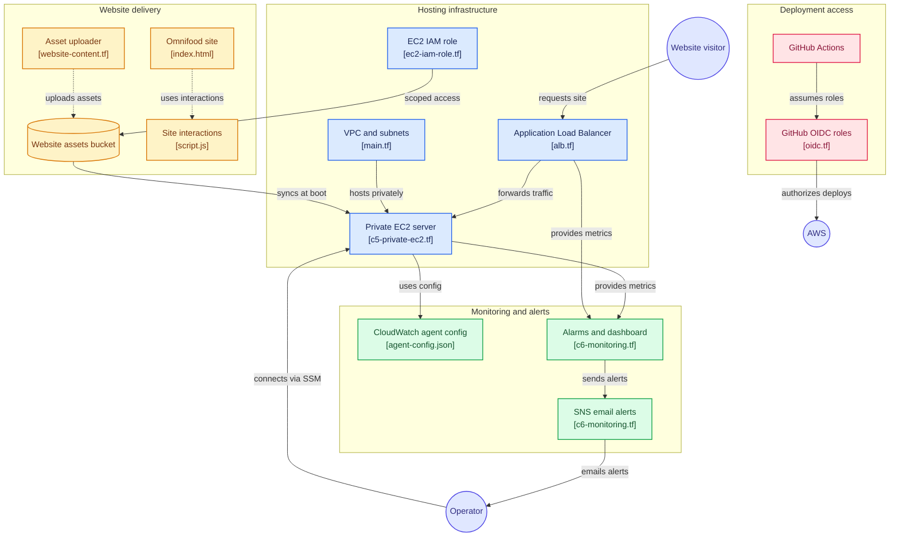
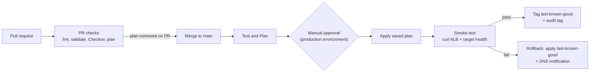

Readme · MD
# Secure Web Hosting on AWS: Terraform, CloudWatch & GitHub Actions CI/CD
 
A three-phase AWS project that hosts a static website (the Omnifood landing page) on a **private EC2 instance** behind an Application Load Balancer, monitors it with **CloudWatch**, and ships every infrastructure change through a **GitHub Actions pipeline** with security scanning, a human approval gate, smoke tests, and **automatic rollback**.
 
The website is just the workload. The point of the project is the infrastructure around it: network isolation, least-privilege IAM, observability, and a safe, auditable deployment path, all defined in Terraform.
 
| | |
|---|---|
| **Cloud / Region** | AWS, `us-east-2` |
| **IaC** | Terraform (AWS provider v6), S3 remote state with native locking |
| **CI/CD** | GitHub Actions, GitHub OIDC federation (no long-lived AWS keys) |
| **Observability** | CloudWatch metrics, alarms, dashboard, CloudWatch Agent, SNS email alerts |
| **Security** | Private subnet, no SSH, IMDSv2, encrypted EBS/S3, Checkov scanning, least-privilege roles |
 
---
 
## What this project demonstrates
 
- Designing a VPC with public and private tiers across multiple Availability Zones
- Serving traffic from an instance that has **no public IP and no SSH access**
- Writing least-privilege IAM for both the workload (EC2 role) and the pipeline (OIDC roles)
- Building monitoring that alerts a human when something breaks (including when the agent itself stops reporting)
- Building a CI/CD pipeline with plan-on-PR, policy scanning, manual approval, post-deploy verification, and rollback
- Debugging real pipeline failures (IAM gaps, state locking, OS argument limits) and documenting the fixes
---

## Project Structure

```
Directory structure:
└── epruitt-vpcwebsitehosting/
    ├── readme.md
    ├── vpcWebsiteHosting/
    │   ├── agent-config.json
    │   ├── c1-versions.tf
    │   ├── c2-variables.tf
    │   ├── c3-vpc.tf
    │   ├── c4-outputs.tf
    │   ├── c5-private-ec2.tf
    │   ├── c6-monitoring.tf
    │   ├── .terraform.lock.hcl
    │   └── modules/
    │       └── vpc/
    │           ├── alb.tf
    │           ├── datasources-and-locals.tf
    │           ├── ec2-iam-role.tf
    │           ├── main.tf
    │           ├── outputs.tf
    │           ├── s3-website-assets.tf
    │           ├── variables.tf
    │           ├── website-content.tf
    │           └── website/
    │               ├── index.html
    │               ├── css/
    │               │   ├── general.css
    │               │   ├── queries.css
    │               │   └── style.css
    │               └── js/
    │                   └── script.js
    ├── vpcWebsiteHosting-bootstrap/
    │   ├── oidc.tf
    │   ├── outputs.tf
    │   ├── version.tf
    │   ├── .terraform.lock.hcl
    │   └── .terraform/
    │       └── providers/
    │           └── registry.terraform.io/
    │               └── hashicorp/
    │                   ├── aws/
    │                   │   └── 6.63.0/
    │                   │       └── darwin_arm64/
    │                   │           └── LICENSE.txt
    │                   └── tls/
    │                       └── 4.4.0/
    │                           └── darwin_arm64/
    │                               └── LICENSE.txt
    └── .github/
        └── workflows/
            ├── terraform-deploy.yml
            └── terraform-pr-check.yml

```



## Technical breakdown
 
### Phase 1: Secure private web hosting
 
**Network** (`modules/vpc`)
- One VPC (`10.0.0.0/16`) with a public and a private subnet in each of three AZs. Subnet CIDRs are computed with `cidrsubnet()` from a single `subnet_newbits` variable instead of being hard-coded.
- Public subnets route to an Internet Gateway; private subnets route through a NAT Gateway so the instance can reach package repos and S3 without being reachable from the internet.
**Traffic path and security groups**
- Internet → ALB (port 80) → EC2 (port 80) → nginx.
- The ALB security group accepts HTTP from anywhere. The EC2 security group accepts port 80 **only from the ALB's security group**, not from a CIDR range. There is no port 22 rule anywhere.
**Compute hardening** (`c5-private-ec2.tf`)
- Instance lives in a private subnet with no public IP.
- **IMDSv2 required** (`http_tokens = "required"`) to mitigate SSRF-style metadata theft.
- **Root EBS volume encrypted.**
- Operator access is through **SSM Session Manager** only: the instance role carries `AmazonSSMManagedInstanceCore` and no key pair is attached.
**Content delivery to the instance**
- Site files are uploaded to a private S3 bucket by Terraform (`fileset` + `for_each`, with a MIME-type lookup so CSS/JS/images are served correctly, and `etag = filemd5()` so only changed files are re-uploaded).
- The bucket blocks all public access, has versioning on, and uses SSE-S3 encryption. The name includes a random suffix to avoid global name collisions.
- At boot, `user_data` installs nginx, starts it immediately (so the ALB health check has something to hit), then runs `aws s3 sync` into the nginx web root with retries, and reloads nginx.
**Least-privilege IAM for the instance**
- Inline policy allows only `s3:ListBucket` on the one bucket and `s3:GetObject` on its objects, plus the two AWS-managed policies for SSM and the CloudWatch Agent.
### Phase 2: Observability
 
- **CloudWatch Agent** installed at boot; its config (`agent-config.json`) is stored in **SSM Parameter Store** and fetched by the agent, so monitoring config is versioned with the infrastructure. It collects memory, disk, and CPU metrics plus nginx error and system logs.
- **Alarms** (all notify SNS on ALARM and OK):
  | Alarm | Condition |
  |---|---|
  | EC2 status check | Any status check failure for 2 minutes |
  | High CPU | > 80% for 3 × 5 min |
  | High memory | > 90% for 2 × 1 min (agent metric) |
  | High disk | > 90% for 2 × 1 min (agent metric) |
  | ALB unhealthy hosts | Any unhealthy target for 2 min |
  | ALB 5xx | > 10 ELB 5xx in a minute, 2 periods |
- Memory and disk alarms use `treat_missing_data = "breaching"`, so if the agent dies or stops reporting, that is itself an alert.
- **SNS topic + email subscription** delivers alerts to the operator. The email address is a `sensitive` variable, supplied in CI from a GitHub secret rather than committed.
- **Dashboard** combines alarm status, EC2 health, network/disk I/O, ALB traffic and latency, host health, and error rates in one view.
### Phase 3: CI/CD pipeline
 
**Authentication: GitHub OIDC, no stored AWS keys**
- GitHub Actions assumes IAM roles via OIDC federation. Trust policies are scoped to this repository and specific refs.
- Two roles with different blast radii:
  - **Plan role**: read-only access plus the ability to read/write/delete the state lock object. Assumable from pull requests and `main`.
  - **Deploy role**: broader write access, assumable **only from `main`**.
**Pull request workflow** (`terraform-pr-check.yml`)
1. `terraform fmt -check`, `init`, `validate`
2. **Checkov** security scan; fails the build on HIGH/CRITICAL findings
3. `terraform plan` using the read-only role, posted back to the PR as a comment (with truncation, and the full plan kept as a downloadable artifact)
**Deploy workflow** (`terraform-deploy.yml`, runs on push to `main`)
1. **Test & Plan**: validate and produce a plan with the read-only role; upload it as an artifact.
2. **Approval**: a job bound to the `production` GitHub Environment pauses for a required reviewer.
3. **Apply**: runs `terraform apply` on the **exact saved plan** that was reviewed, using the deploy role.
4. **Smoke test**: waits for ALB propagation, `curl`s the ALB DNS name with retries, and verifies the target group reports `healthy`.
5. **Success path**: moves a `last-known-good` git tag to the deployed commit and adds a timestamped `deployed-*` audit tag.
6. **Failure path**: if apply or the smoke test fails, the pipeline checks out `last-known-good`, re-applies it, and publishes an SNS message so a human knows a rollback happened.
7. **Destroy** is available only through a manual `workflow_dispatch`, and requires the same approval gate.
A workflow-level `concurrency` group (with `cancel-in-progress: false`) prevents two applies from racing against the same state.
 
---
 
## Key decisions and why
 
| Decision | Why |
|---|---|
| **EC2 in a private subnet behind an ALB** | Removes direct internet exposure; the ALB is the only entry point and the only thing the instance's security group trusts. |
| **SSM Session Manager instead of SSH/bastion** | No inbound admin port, no key management, and sessions are auditable. |
| **Security group references, not CIDRs, for ALB→EC2** | Rule stays correct if IPs change and cannot be satisfied by anything except the ALB. |
| **S3 as the content source (private bucket + role) instead of baking files into the instance** | Content updates are decoupled from instance config, the bucket stays private, and the instance only needs read access to one bucket. |
| **Retries and verification in the bootstrap script** | Package repo metadata and IAM credentials can lag right after launch. Retrying nginx install and S3 sync, and starting nginx before the sync, makes first boot reliable. |
| **Agent config in SSM Parameter Store** | Monitoring config is managed by Terraform and fetched at boot instead of being baked into the instance. |
| **OIDC instead of IAM user access keys** | No long-lived secrets in GitHub; tokens are short-lived and bound to repo/branch claims. |
| **Separate plan and deploy roles** | PR code (untrusted until reviewed) can only read. Only merged code on `main` can change infrastructure. |
| **Bootstrap module with its own state** | CI cannot create the OIDC provider and roles it depends on to run (chicken-and-egg). Those are created once with admin credentials in `vpcWebsiteHosting-bootstrap/`, then CI manages everything else. |
| **Apply the saved plan after approval** | The reviewer approves exactly what will be applied, with no drift between review and apply. |
| **Smoke test + `last-known-good` tag for rollback** | A deploy is only "good" if the site actually responds and the target is healthy; rollback re-applies the last commit that passed. |
| **S3 native state locking (`use_lockfile`)** | Removes the need for a DynamoDB lock table. |
| **Checkov gating on severity, not a check-ID allowlist** | New findings are caught automatically instead of silently skipped. |
| **Terminal-only validation (AWS CLI, `gh`, SSM, `curl`)** | Every check is scriptable and repeatable, with no console click-paths. |
---
 ## Problems I hit and how I solved them
 
| Problem | Root cause | Fix |
|---|---|---|
| PR plan job exited non-zero though the plan succeeded | Plan role lacked `s3:DeleteObject`, so it couldn't release the S3 native lock file | Added the permission to the plan role policy |
| "Post Plan to PR" step crashed with `E2BIG` / "Argument list too long" | A ~97-resource plan was passed through `${{ }}` interpolation and env vars into a subprocess | Write plan output to a file, truncate to fit GitHub's comment limit, read it from disk in the script step |
| Nginx didn't install / user_data ignored changes | A leading space before `#!/bin/bash` made cloud-init fall back to `dash`; `user_data` changes also didn't force replacement | Strip whitespace with `trimspace()`, enable `user_data_replace_on_change`, add install retries |
| Deploy role got `AccessDenied` on SSM tags / S3 bucket reads | Provider reads many sub-resources on refresh; policy listed actions too narrowly | Added the missing tagging and bucket-read permissions, scoped to the project's resource prefixes |
| CI could not apply its own IAM changes | Pipeline depends on the very roles it manages | Split roles into the bootstrap module; use a one-time targeted local `apply` with admin credentials for IAM changes |
| GitHub API calls failed with type errors | `gh api -f` sends everything as strings | Send JSON with `--input -` |
| Formatting failures blocked CI | `terraform fmt -check` is enforced | `terraform fmt -recursive` before every push |
---
 
## Deploying it yourself
 
Prerequisites: AWS account and CLI credentials, Terraform ≥ 1.0, an existing S3 bucket for remote state (update the `backend "s3"` block), and the GitHub CLI.
 
1. **Bootstrap (once, with admin credentials)**: `cd vpcWebsiteHosting-bootstrap && terraform init && terraform apply`. Note the two role ARNs it outputs.
2. **Configure GitHub**: set repo secrets `AWS_PLAN_ROLE_ARN`, `AWS_DEPLOY_ROLE_ARN`, and `TF_VAR_ALERT_EMAIL`; create the `production` environment with a required reviewer; enable branch protection on `main` requiring the PR check jobs.
3. **Seed the rollback tag**: create the initial `last-known-good` tag on a known-good commit.
4. **Ship it**: open a PR; review the plan comment; merge; approve the deployment.
5. **Confirm alerts**: click the SNS confirmation link sent to your alert email.
6. **Verify** with the CLI: `curl` the `alb_dns_name` output, then `aws ssm start-session` to the instance and check `/var/log/user-data.log` and `systemctl status nginx`.
---
 
## Known limitations and next steps
 
Being upfront about scope, since this is a portfolio build rather than a production system:
 
- **HTTP only.** An ACM certificate, HTTPS listener, and HTTP→HTTPS redirect are the next step (the port 443 security group rule is already stubbed out).
- **Single instance, single NAT gateway.** Fine for a demo; production would use an Auto Scaling group across AZs and a NAT gateway per AZ.
- **Agent metric dimensions.** The memory/disk alarms filter on `InstanceId`, so the CloudWatch Agent config should publish that dimension (via `append_dimensions`). Worth verifying the metrics appear in the `CWAgent` namespace.
- **Deploy role is broad in places** (`ec2:*`, `elasticloadbalancing:*`, `s3:Get*`). A narrowing pass is planned.
- **Inline `user_data`.** Moving the bootstrap script to `templatefile()` would make it lintable and easier to read.
- **Rollback scope.** Rollback re-applies the previous commit's Terraform; it does not restore data, which is fine here because the site is stateless.

---

## Author
 
**Emanuel Pruitt**: Cloud/DevOps engineer, 
GitHub: [github.com/epruitt](https://github.com/epruitt)